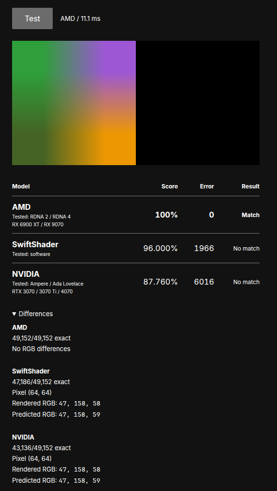

# PixelTells: Fingerprinting Rendering Operations in Canvas2D

<p align="center">
  
</p>

Instead of hashing a canvas, PixelTells compares its pixels against formulas for AMD, NVIDIA, and SwiftShader rendering.
The test enlarges four colors. Small differences in filtering and rounding give us different byte values—even when the images look identical.

Small numerical differences reveal which measured rendering formula fits the result.

> [!WARNING]
> **Disclaimer:** This project is a work in progress!.


**[Read the research and try the interactive pixel test →](https://yacinesellami.com/blog/pixeltells/)**

## Formulas

These formulas reproduce the outputs we tested. For each color channel, a,b,c,d are the four source values: top-left, top-right, bottom-left, and bottom-right. We sample pixels at coordinates 64..191.

### Shared inputs

`S,T` locate the sample between the source pixels. `N` is their weighted color sum, used by AMD and SwiftShader.

```text
S = 2*x - 127
T = 2*y - 127
N = (256-S)*(256-T)*a + S*(256-T)*b + (256-S)*T*c + S*T*d
```

`F32` rounds to float32; `RNE` rounds to the nearest integer, ties-even; `RTZ16` truncates to float16.

### AMD

Quantize the sum, normalize it, truncate through float16, then convert to a byte.

```text
byte = RNE(255 * RTZ16(F32(RNE(N/8) / (8192*255))))
```

### NVIDIA

Round the cross-weight, combine the colors, then convert through fixed12 precision.

```text
w = (S*T + 128) >> 8
n = (256+w-S-T)*a + (S-w)*b + (T-w)*c + w*d
v = F32(((257*n + 128) >> 8) / 65535)
byte = (255*floor(4096*v) + 2047) >> 12
```

### SwiftShader

Normalize using a float32-rounded reciprocal, then multiply by 255 in float32 and round to a byte.

```text
byte = RNE(F32(255 * F32((N/256) * F32(1/65280))))
```


## Test results


| GPU | Architecture | Observed/reported result |
| --- | --- | --- |
| RX 6900 XT | RDNA 2 | AMD match |
| RX 9070 | RDNA 4 | AMD match |
| RTX 3070 / 3070 Ti | Ampere | NVIDIA match |
| RTX 4070 | Ada Lovelace | NVIDIA match |
| RX 580 | Polaris | Unmatched |
| RTX 5080 | Blackwell | Unmatched |


## Benchmark  of the implementaiton written in C++.

on a Ryzen 9 9900X.

| Implementation | Median verification time |
| --- | --- |
| Floating-point scalar reference | 141.742 µs |
| Integer AVX-512 checker | 5.887 µs |

**24.08× faster.** !

## Run

Browser app:

```sh
npm ci
npm run dev
```

Portable C++17 CLI, with no AVX-512 requirement:

```sh
c++ -O3 -std=c++17 -ffp-contract=off pixeltells.cpp -o PixelTells
./PixelTells --help
```
